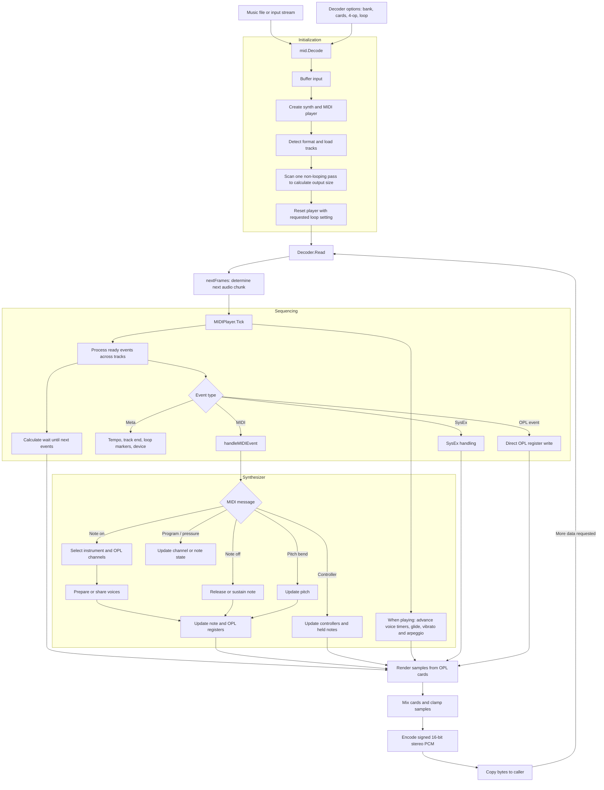

# MIDI decoder workflow

The MIDI decoder turns a supported music file into interleaved, signed 16-bit
little-endian stereo PCM. It uses an OPL synthesizer to render the audio.

`Decode` scans the sequence to calculate its size, then resets the player;
it does not render PCM during that scan. Audio is rendered as the caller reads.
At the end of a non-looping pass, the decoder renders a one-second tail before
returning EOF. Looping follows the sequencer's loop markers; reported size and
duration still describe one non-looping pass.

Key implementation entry points:

- [`Decode`, `nextFrames`, and `Read`](../decoder.go)
- [`MIDIPlayer.Tick`](../player.go)
- [`ProcessEvents` and `HandleEvent`](../sequencer.go)
- [`handleMIDIEvent` and MIDI event handlers](../events.go)
- [Voice allocation and synth updates](../synth.go)
