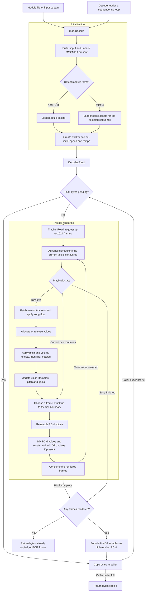

# Module decoder workflow

The module decoder turns a supported S3M, IT, or experimental MPTM file into
interleaved, 32-bit little-endian float stereo PCM at 48 kHz. The tracker
resamples PCM voices and mixes in OPL audio when present.

`Decode` reads the whole input, but it does not scan or render the song to
calculate a duration. Audio is rendered on demand into reusable buffers.
`Read` accepts any buffer length, even one that splits a stereo frame, and
keeps leftover bytes for the next copy. `Close` releases playback state
without closing the input reader.

MPTM selects sequence zero by default; S3M and IT only accept sequence zero.
`NoLoop` stops playback when the same order, row and pattern-loop counters
recur, without disabling sample loops or finite pattern loops. MPTM uses this
termination behavior by default; some S3M and IT songs can otherwise loop
indefinitely.

Key implementation entry points:

- [`Decode`, `Read`, and `DecoderOptions`](../decoder.go)
- [S3M loader](../loader_s3m.go), [IT loader and MMCMP unpacking](../loader_it.go),
  and [MPTM sequence loader](../loader_mptm.go)
- [`NewTracker`](../tracker.go)
- [Tick scheduling and voice allocation](../system_controls.go)
- [Pitch and volume effects](../system_effect.go) and [filter macros](../mpt_filter_macro.go)
- [`Tracker.Read`, resampling and mixing](../system_audio.go)
