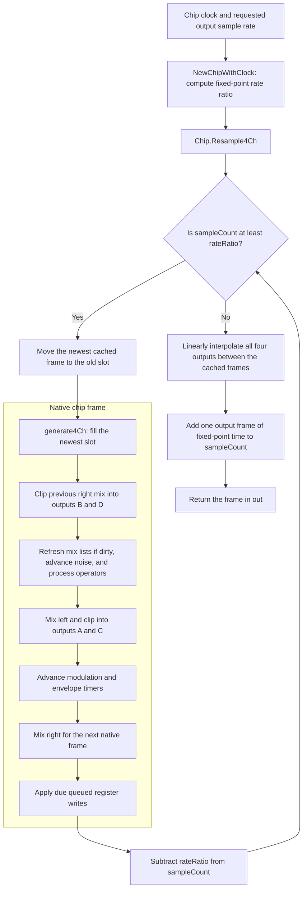

# OPL3 four-channel resampling workflow

`Chip.Resample4Ch` writes one output frame as four signed 16-bit samples:
OPL3 outputs A, B, C and D, in that order. It interpolates between two cached
frames generated at the chip's native rate.

`sampleCount` and `rateRatio` use 10 fractional bits. Each call adds `1 << 10`
to `sampleCount`; each native frame generated subtracts `rateRatio`. The
remaining `sampleCount / rateRatio` is the interpolation weight for the newer
frame. A call may generate zero, one or several native frames before writing
its single output frame. Queued register writes advance with native frames,
not with calls to `Resample4Ch`.

The caller supplies space for at least four samples. `Resample2Ch` keeps only
A and B; `Stream4Ch` splits the outputs into two interleaved stereo pairs,
A/B and C/D.

Key implementation entry points:

- [`NewChipWithClock`, `Resample4Ch`, and `generate4Ch`](../chip.go)
- [`lerp` and `clip16`](../math.go)
- [Buffered register writes](../wring.go)
